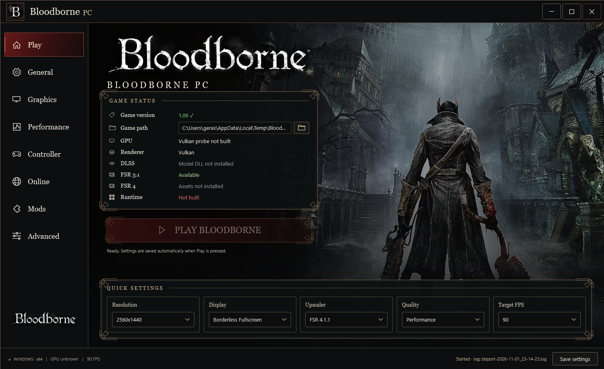
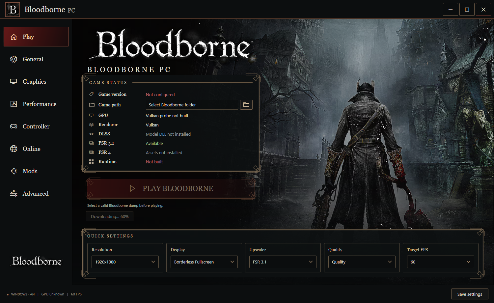
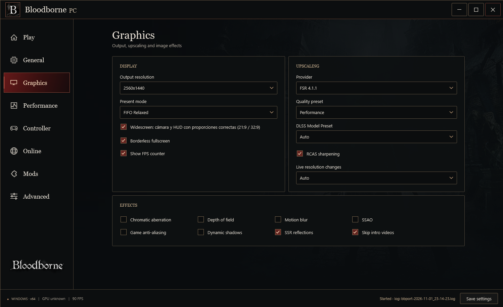
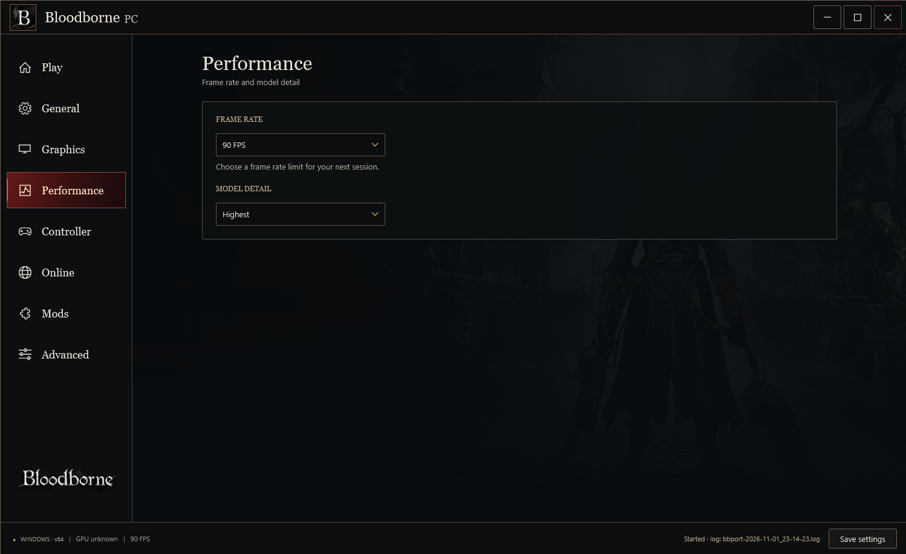
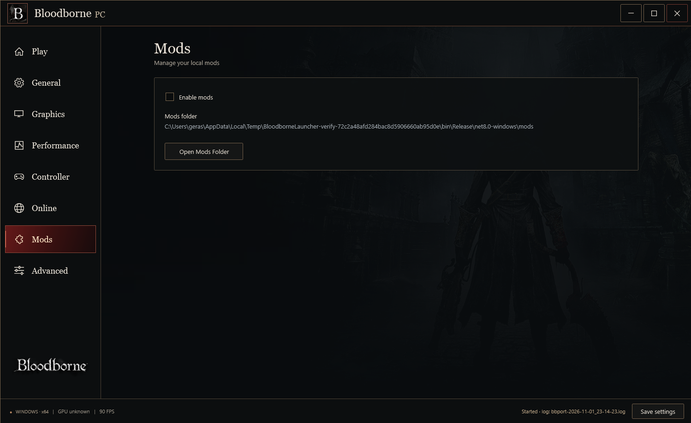

# Bloodborne PC

A native Windows port of **Bloodborne** with its own launcher. It renders with
Vulkan and supports DLSS, FSR, keyboard and mouse, gamepads, ultrawide screens,
file mods and online play through a shadNet server.

**[Download the latest release](https://github.com/GerasimosKan/bloodborne_pc/releases/latest)**



This is GerasimosKan's fork of
[DarkIzuku's fork](https://github.com/DarkIzuku/bloodborne_pc), which is based on
[deadinside28's bbport](https://github.com/deadinside28/bloodborne_pc). The
game's x86-64 code runs directly on the CPU. The runtime replaces the PS4 system
libraries, and a renderer derived from shadPS4 translates the graphics to Vulkan.
It is not an official Sony, FromSoftware or shadPS4 release.

> **No game files are included.** No game data, firmware or saves come with this
> project. You need your own dump of Bloodborne version **1.09**. The launcher
> does not download game files and does not decrypt encrypted dumps.

The port is experimental. Not every area, mod or hardware setup has been tested.

## For players

### What you need

- Windows 10 (version 1803 or newer) or Windows 11, on an x86-64 CPU.
- A graphics card and driver with Vulkan 1.3. DLSS and FSR 4 have their own
  hardware requirements.
- Your own Bloodborne 1.09 dump, with its required modules.
- Enough RAM, page-file space and disk space for the game and its caches.

You do not need to install anything else. The release contains the launcher with
its .NET runtime, a Python runtime for preparing the game, and the other
libraries it needs.

### Download and first run

1. Open the [latest release](https://github.com/GerasimosKan/bloodborne_pc/releases/latest)
   and download `UPDATE.<version>-Bloodborne-PC.zip`.
2. Optional: check the download against the `SHA256SUMS` file from the same
   release. In PowerShell, `Get-FileHash <zip>` must print the same hash.
3. Extract the whole zip into a folder you can write to, for example
   `D:\Bloodborne`. Keep all subfolders and DLLs together.
4. Start **BloodborneLauncher.exe**.
5. On the **Play** page, click the folder button next to **Game path** and pick
   your Bloodborne folder. **Game version** shows `1.09` when the dump is valid.
6. Pick your settings and press **PLAY BLOODBORNE**. Settings are saved when you
   press Play.

The launcher checks the game folder and prepares the executable, the PC menus
and your enabled mods on its own. You only choose the game folder once. The
launcher hides while the game runs and comes back when you quit.

### Updating

The launcher updates itself. When a newer release is out, a button appears under
**PLAY BLOODBORNE**, for example `Update v0.8 → v0.9`. Click it and confirm.



The launcher then:

1. downloads the new zip,
2. checks it against the release's `SHA256SUMS` and stops if they do not match,
3. installs it over your current folder,
4. restarts itself.

Your `bbport.ini`, `launcher-settings.json`, `mods` folder and game dump are
kept. Files you edited inside `patches\` or `scripts\` are replaced. Close the
game before you update.

If the update fails partway, press the update button again to finish it. If
you have no internet connection, the launcher skips the check and works as
usual. You can also update by hand: download the new zip and extract it over
your folder.

### What you can set



- **Display:** windowed or borderless fullscreen, 720p to 4K, and ultrawide
  resolutions (21:9 and 32:9, up to 5120x2160) with corrected camera and HUD
  proportions.
- **Upscaling:** DLSS Super Resolution and DLAA with a DLSS model preset,
  FSR 3.1, FSR 4, FSR 4.1.1, or native TAA, with optional RCAS sharpening.
  - DLSS needs an NVIDIA card. The installed NVIDIA DLL decides which models
    are available.
  - FSR 4 needs compatible Vulkan features and its shader assets.
  - FSR 4.1.1 assets are not shipped. You build them on your own PC from a
    compatible AMD DLL that you supply.
- **Effects:** turn chromatic aberration, depth of field, motion blur, SSAO,
  dynamic shadows, SSR reflections and the game's anti-aliasing on or off. You
  can also skip the intro videos.
- **Frame rate:** 30, 60, 90, 120 FPS or Unlimited, plus a model-detail setting
  and an optional FPS counter. The title menu stays at 60 FPS. 120 FPS and
  Unlimited need FIFO (VSync) as the present mode. Your hardware may not reach the limit you pick.
- **Controls:** remappable keyboard and mouse, mouse camera, mouse menu
  selection, and SDL gamepads (you can pick which gamepad is active). Button
  prompts show keyboard/mouse or Xbox labels; PlayStation controllers keep the
  original glyphs.
- **In-game PC menus:** graphics and camera settings, FOV, key bindings and local
  trophies.
- **Gameplay options:** edit your appearance at the Hunter's Dream mirror, and
  reset attributes at the Altar of Despair.
- **Diagnostics:** every session writes a log. Detailed logs are optional, and
  **Open Logs Folder** takes you to them.



### Mods



Put each mod in its own folder inside `mods\`, then turn on **Enable mods** on
the **Mods** page. Each mod and each patch has its own switch, so you can turn
them on and off one at a time. Changes apply the next time you start the game.

- The loader accepts mods with a `dvdroot_ps4\` folder, common wrapper folders,
  or bare game folders such as `chr\` or `parts\`. Unpack ZIP and 7z archives
  first.
- When two mods replace the same file, the one later in the load order wins.
- Your original game files are never overwritten.
- Mods may include XML patches or a modified `eboot.bin`. A modified `eboot.bin`
  is turned into small checked patches against a matching executable; it never
  replaces the original. Mods that replace system modules are rejected.
- Third-party mods can still conflict with each other.

More detail (in Russian): [docs/MODS.md](docs/MODS.md).

### Online

Online play uses a shadNet server that you choose. No server or account is set
by default. On the **Online** page, turn on online play and enter the server's
host, TCP port and WebAPI URL. Then log in with an account from that server's
website. You can let Windows remember the account; passwords are never written
to `bbport.ini` or `launcher-settings.json`.

Trophies are stored locally only. See [docs/online.md](docs/online.md) for the
full setup.

### Settings and saves

- `bbport.ini` holds the game and graphics settings.
- `launcher-settings.json` holds the launcher's own settings.
- When the launcher writes a settings file, it keeps the previous one as `.bak`.
- Saves are usually in `user\` inside the data folder. Back them up before you
  install third-party mods or switch to a different build.

## For developers

### Build from source

You need **MSYS2 CLANG64** (Clang, libc++, LLD, CMake, Ninja, SDL3, Vulkan and the
libraries listed in the Windows workflow) and the **.NET 8 SDK**. Clone with
submodules; GitHub's source ZIP does not include them.

```sh
git clone --recursive https://github.com/GerasimosKan/bloodborne_pc.git
cd bloodborne_pc
bash build.sh
```

Run `build.sh` in a CLANG64 shell. The exact dependencies and test targets are in
[the Windows workflow](.github/workflows/windows-offline-build.yml).

### Build the launcher and a release package

From PowerShell in the repository folder:

```powershell
.\launcher-windows\build-launcher.ps1                                # runtime + launcher + zip
.\launcher-windows\build-launcher.ps1 -InstallDir D:\Bloodborne      # also upgrade that install
.\launcher-windows\build-launcher.ps1 -Version 0.9                   # set the version
```

Other switches: `-NoZip`, `-SkipRuntime` (reuse the runtime in `out\`) and
`-SkipTests`. The script needs `tools\python`, `fsr4_shaders` and
`out\nvngx_dlss.dll` from an existing install, given once with `-AssetsDir` or
`-InstallDir`.

It writes `dist\UPDATE.<version>-Bloodborne-PC.zip` and `dist\SHA256SUMS`.
Without `-Version`, the version is one more than the last package
(0.8, 0.9, 0.10 …).

To publish a release, create a GitHub release tagged `v<version>` (for example
`v0.9`) and upload both files. The launcher's updater only offers a release
whose tag is a plain version number higher than the installed one, and only when
both the zip and `SHA256SUMS` are attached.

### Tests

CI checks C++ regressions, frame pacing, preparation and patch safety, crash
capture, and launcher settings and lifecycle. Gameplay, image quality and
driver-specific behavior still need testing by hand.

### Further reading

- [Stability notes](docs/PUBLIC_STABILITY.md)
- [Frame pacing on Windows](docs/FRAME_PACING_WINDOWS.md)
- [Upscalers](docs/upscaler.md)
- [Online](docs/online.md)
- [Mods](docs/MODS.md)

## Credits

Thanks to **deadinside28** for bbport; **shadPS4** and its contributors for the
renderer foundation; **droogie/bbhost** for engine, controls and menu work;
**DarkIzuku** for the Windows fork this one builds on; **AwesomeObserver**,
**Awakenchan**, **Supermedo** and other contributors for stability research; and
**Gerasimos Kanellatos (GerasimosKan)** for trophies, menus, prompts, mods, the
updater and Windows tooling.

## License

Existing code keeps its original notices, including GPL-2.0-or-later code.
Adaptations that use its later-version grant are GPL-3.0-or-later. See
[LICENSE](LICENSE), the source file headers, and [licenses/](licenses) for
adaptation details and third-party notices. NVIDIA, AMD and other components
keep their own terms.

Русская версия: [README.ru.md](README.ru.md).
